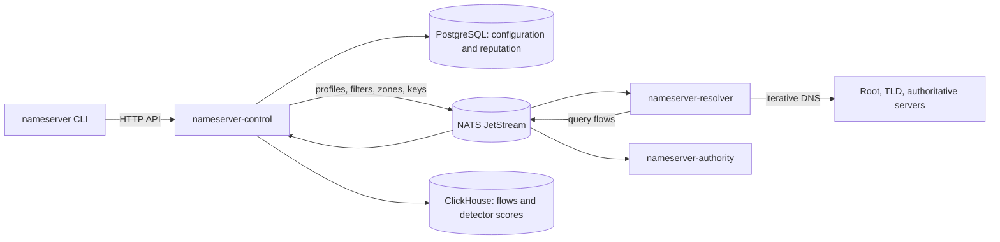

# Components and boundaries

Nameserver has four core executables. Resolver and authority are separate DNS roles. The CLI and control plane form the management layer for both roles.

- `nameserver-resolver` follows DNS delegations, caches results, validates DNSSEC, and enforces filtering. Forwarding is a separate, explicit configuration mode.
- `nameserver-authority` serves the records for hosted zones and signs them when DNSSEC is enabled. It never performs recursion.
- `nameserver-control` owns management APIs, feed parsing and compilation, profiles, zone publication, flow ingestion, reputation, GeoIP, RDAP, and detector APIs.
- `nameserver` is the CLI controller. Its management commands call the control-plane API. Diagnostic commands such as DNS queries, JARM, and stamp generation can operate independently.

The workspace also includes `nameserver-common` for management protocol types and compiled artifact formats, and `nameserver-core` for shared DNS listeners, admission control, TLS, and configuration reloads.

## Standalone and managed operation

Without a `[management]` section, each DNS server starts from local files. Adding `[management]` connects it to NATS. The control plane does not sit in the DNS request path. Loaded shared filters and authoritative catalogs remain in memory during a control-plane outage. Profiles already loaded on a node remain cached; fetching an unknown profile requires NATS.

Local resolver filter files remain available in managed mode. Managed profile policy is selected with a DoH path, DoT SNI prefix, or `management.default_profile` for ordinary requests. An unknown requested profile is rejected. The authority can serve local and managed zones together, provided their origins do not overlap exactly. Managed zone replacement is atomic and retains the current catalog if parsing or signing fails.

## Preserved management features

The CLI and API retain profile CRUD and diff/apply, custom allow/block entries, domain and IP filters, feed/source management and compilation, GeoIP/ASN and public suffix data, zone diff/apply, KSK/ZSK generation and DS output, live flows, stored analytics, reputation, detector scores, RDAP, DNS stamps, JARM, and Apple configuration profiles. ACME issuance, leader election, certificate distribution, renewal, and DNS-01 TXT synchronization are available through resolver management TLS settings.

Automatic feed polling, RDAP enrichment, the resolution injector, benign sampling, and ML inference are opt-in. Their management and inspection APIs stay present in the default build. ML additionally requires the `ml` Cargo feature, an ONNX Runtime shared library, and the model bundle. Training scripts and the tracked inference models are retained under `ml/`; datasets and machine-specific deployments are excluded.

## Recursive engine and telemetry

The DNS data plane uses Hickory 0.26.3. The recursive service uses its iterative recursor and validating resolver; CD requests use a separate nonvalidating view. Management utilities use their existing Hickory 0.25 wire types at an explicit serialization boundary. They do not supply DNSSEC decisions.

Recursive flow paths contain real upstream exchanges observed by a connection adapter, including referrals, answers, CNAMEs, timings, and errors. Cache hits may have no new upstream exchanges. Forward mode does not expose the upstream resolver's internal delegation path. DNSSEC status comes from the validating engine, and unchecked requests are reported as indeterminate.

Hickory labels its recursive engine experimental. The management and research code is a personal-project codebase and should be evaluated before production use. The existing ZSK rollover command replaces the active ZSK immediately; operators must account for cached DNSKEY sets and plan rollover timing before using it on delegated production zones.
